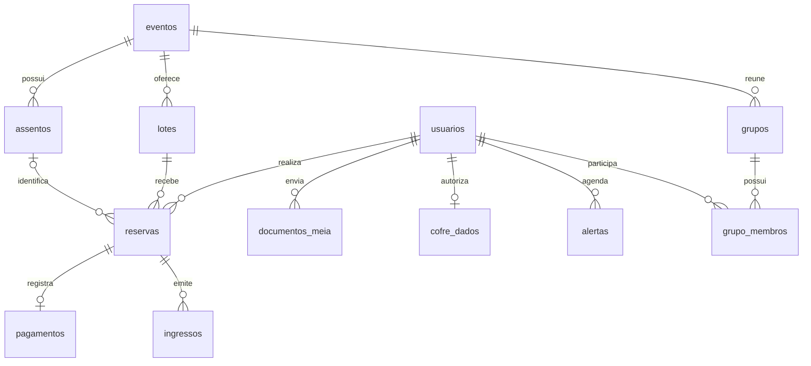
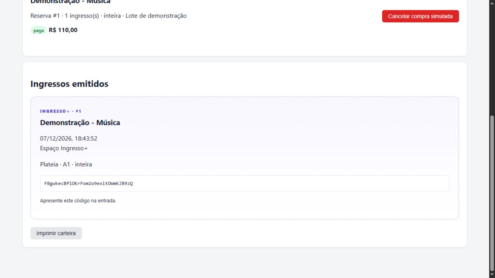

# Ingresso+

Sistema acadêmico com React/Vite, Flask e **MySQL 8.4 com SQL puro**, executado
pelo Docker Compose. O CRUD anterior, buscas, filtros e relatório de categorias
foram preservados e ampliados com dez módulos de venda de ingressos.

**Pagamentos e estornos são simulados, sem cobrança real.** O comparador usa
canais fictícios. As recomendações funcionam localmente, sem chave de IA.
Não há certificação LGPD/PCI-DSS nem gateway externo conectado.

## Executar

Na primeira instalação, copie o modelo. Se já existe `.env`, preserve suas chaves.

```powershell
Copy-Item .env.example .env
docker compose up --build -d
docker compose exec backend flask criar-demo
```

O comando `criar-demo` é opcional: cria três eventos fictícios, lotes, um mapa e
duas contas de teste. Não altera senhas ou registros anteriores.

| Conta de demonstração | E-mail | Senha |
|---|---|---|
| Administrador | `admin@ingressoplus.local` | `DemoIngresso123!` |
| Cliente | `cliente@ingressoplus.local` | `DemoIngresso123!` |

- Interface: [localhost:5173](http://localhost:5173)
- API: [localhost:5000/api/health](http://localhost:5000/api/health)
- MySQL: `localhost:3307`, ou `db:3306` na rede Docker.
- O worker processa alertas internos e expira reservas a cada 10 segundos.

As tabelas, a coluna de papel do usuário e a Stored Procedure são inicializadas
pelo backend. O primeiro usuário anterior é preservado como administrador na
atualização. `flask init-db` permite repetir a inicialização desta versão.

## Vinte recursos do documento de referência

| # | Funcionalidade | Comportamento entregue |
|---|---|---|
| 01 | Notificações de abertura | Avisos internos com leitura e cancelamento |
| 02 | Dados seguros | Cofre criptografado com consentimento e revogação |
| 03 | Compra expressa | Reserva, pagamento simulado e emissão em uma transação |
| 04 | Monitoramento de lotes | Estoque atualizado automaticamente e conferido no servidor |
| 05 | Comparador de taxas | Quantidade/modalidade e canais parceiros fictícios |
| 06 | Mapa interativo | Assentos numerados selecionáveis e ocupação atualizada |
| 07 | Grupos | Convites, participantes e totais individuais |
| 08 | Painel de ingressos | Carteira, códigos, situação e impressão |
| 09 | Regras de meia-entrada | Categorias e critérios de demonstração |
| 10 | Privacidade | Exportação própria, consentimento e histórico, sem certificação legal |
| 11 | Autenticação | Login, logout, sessão HttpOnly e papéis cliente/admin |
| 12 | Perfil | Cadastro e edição dos próprios dados |
| 13 | Gestão de eventos | CRUD existente, lotes, capacidade e mapa |
| 14 | Reservas | Prazo de 15 minutos, cancelamento e liberação de estoque |
| 15 | Documento de meia | Upload privado, análise manual e validade |
| 16 | Relatório de vendas | Ingressos, arrecadação simulada, taxas e lotes |
| 17 | Pagamento | Simulador aprovado/recusado; gateway externo não conectado |
| 18 | Recomendações | Histórico e preferências locais; adaptador Gemini opcional |
| 19 | Ocupação por Stored Procedure | `obter_mapa_assentos`, chamada pelo Repository |
| 20 | Alertas por lote | Abertura geral ou específica, com processamento pelo worker |

Veja a [matriz de módulos, telas e rotas](docs/FUNCIONALIDADES_20.md).

## Estrutura

```text
backend/
  app/
    controllers/    rotas HTTP e permissões
    services/       validações e fluxos de negócio
    models/         entidades e CRUD básico
    repositories/   consultas agregadas e Stored Procedure
    utils/          sessão, validações e conversões
    extensions.py   conexões e transações MySQL
  migrations/versions/  esquema SQL e procedimento de ocupação
  tests/            regressões e fluxos no MySQL isolado
  worker.py         processamento periódico
frontend/src/
  api/              cliente HTTP com cookies de sessão
  components/       sessão, mapa, mensagens e formulários
  pages/            eventos, conta, ingressos, grupos, alertas e relatórios
```

O código mantém funções comuns e classes simples para preservar a adaptação
anterior de legibilidade. Não utiliza `db.Model`, SQLAlchemy, Flask-Migrate,
classes de serviço por operação ou JWT. Essas escolhas diferem do modelo de
arquitetura sugerido no PDF: as pastas existentes foram preservadas, com SQL
puro e autenticação por sessão.

Consultas recebem parâmetros `%s` separados dos valores. Compras usam
transações e `FOR UPDATE`; estoque e assento são conferidos dentro da transação.
Dinheiro usa `Decimal`. Um pagamento aprovado repetido não emite novos ingressos.



## Testar

```powershell
docker compose --profile testes run --build --rm testes
docker compose exec frontend npm run build
docker compose exec backend python -m compileall app
```

A suíte só executa em banco terminado em `_test`, em outro container sem porta
publicada, com dados temporários em `tmpfs`. Ela limpa apenas esse banco.
**Não execute a suíte no serviço `backend` ligado aos dados reais.**

Há regressões do CRUD e testes de permissões, privacidade, criptografia,
meia-entrada, expiração, pagamentos repetidos, cancelamento, grupos, alertas,
relatórios e compras concorrentes disputando estoque ou assento.

## Demonstrar

1. Entre como cliente e abra um evento `Demonstração`.
2. Selecione lote, modalidade e assento; confira o comparador.
3. Reserve e simule aprovação ou recusa na carteira.
4. Confira o ingresso emitido ou cancele a compra simulada antes do evento.
5. Envie um comprovante fictício de meia-entrada; entre como admin para analisar.
6. Crie um grupo e compartilhe seu código com outra conta de teste.
7. Agende um aviso para daqui a um minuto e acompanhe em Alertas.
8. Edite o perfil, autorize o cofre e exporte os próprios dados.
9. Como admin, configure lotes/mapa, consulte vendas e valide um ingresso na portaria.
10. Um código validado não pode ser utilizado novamente.



## Configuração e limites

- `.env` e `backups/` são ignorados pelo Git. Preserve as chaves do cofre.
- O cofre criptografa os campos adicionais. Nome/CPF/e-mail da tabela principal
  continuam disponíveis às rotas administrativas autorizadas.
- Comprovantes são privados, limitados a 2 MB e analisados manualmente.
  Não existe verificação documental externa.
- Alertas são internos, sem e-mail, SMS ou push fora do sistema.
- Nenhum cartão é solicitado ou armazenado. O simulador não movimenta dinheiro.
- `USAR_GEMINI=false` é o padrão. Para o adaptador opcional, configure
  `GEMINI_API_KEY`, `GEMINI_MODEL` disponível na sua conta e `USAR_GEMINI=true`.
  O serviço envia apenas nomes/categorias de eventos e categorias de interesse;
  falhas voltam ao resultado local. Não houve homologação com conta externa.
- Chaves estrangeiras impedem apagar usuários/eventos com histórico relacionado.
- O mapa pode ser criado uma única vez, antes da primeira reserva.
- Datas são armazenadas em UTC e exibidas no fuso do navegador.

Detalhes: [ambiente local](docs/AMBIENTE_LOCAL.md) e [validação](docs/VALIDACAO.md).

## Equipe

Bernardo Garajau · Caio Matos · Hugo Silva · Julia Cordeiro · Luca Torres.

## Referências

- [PyMySQL](https://pymysql.readthedocs.io/en/latest/user/examples.html)
- [MySQL no Docker](https://hub.docker.com/_/mysql)
- [Gemini generateContent](https://ai.google.dev/api/generate-content)
